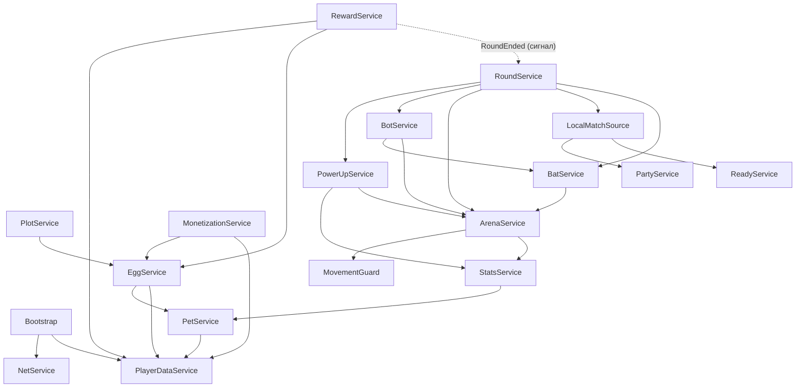

# Pet Keyboard Arena: дизайн и архитектура (v0.2)

Дата: 2026-10-10. Статус: решения D1–D10 подтверждены Иваном. v0.2: добавлена бита (D11, раздел 4.3).

Обозначения:
- **[Требование]**: сказал Иван.
- **[Допущение]**: моё решение, можно поменять.
- **[Решение?]**: нужно подтверждение Ивана (сводка в разделе 0).

---

## 0. Решения, которые нужно подтвердить

| # | Вопрос | Моё предложение |
|---|--------|-----------------|
| D1 | Ритм раунда | Цикл ~85 с: 15 с подготовки, 3 с отсчёта, 60 с раунда, 5 с итогов. «Каждую минуту» в чистом виде не получится, потому что нужно время на выбор яйца и сбор команд. |
| D2 | Как выбирать из 4 яиц, чтобы выбор был интересным | Яйца различаются не только редкостью, но и **набором питомцев** (тема: «Огненные», «Ледяные» и т. п.). Тогда выбор звучит как «редкое из нужной коллекции или эпическое из чужой», а не просто «взять лучшее». |
| D3 | Как вылупляются яйца | Яйцо ставится в **инкубатор на участке** и вылупляется по таймеру (от 30 с до 30 мин реального времени). Это даёт причину возвращаться, трату для монет и место для монетизации. |
| D4 | На что тратить монеты | Рероллы, новые инкубаторы, ускорение инкубации, расширение хранилища питомцев. Позже: слияние питомцев (5 одинаковых дают золотого). |
| D5 | Потолки бонусов питомцев | В раунде: скорость не больше +25%, кисть не больше +50%. В наградах: удача не больше +100%, монеты не больше +100%. Сила биты (Power) не больше +60% (2026-10-12). Команды балансируются по суммарной силе. |
| D6 | Боты | Если готовых игроков меньше 8, раунд идёт 4 на 4 и пустые места занимают боты. Если готовых нечётное число, недостающее место тоже занимает бот. |
| D7 | Платный 4-й слот питомца | Это влияет на баланс. Предлагаю **не продавать** его в первой версии и оставить чисто косметические и «удобные» покупки. |
| D8 | Как ты будешь тестировать | Каждый этап я собираю в готовый файл места (.rbxl) через GitHub. Ты скачиваешь его, открываешь в Studio и жмёшь Play. Rojo-синхронизация в реальном времени остаётся по желанию. |
| D9 | Хранение данных | Библиотека **ProfileStore** (loleris) вместо самописной. Она проверена тысячами игр, умеет блокировать сессию и защищает от дублирования. |
| D11 | Бита (добавлена по просьбе Ивана) | Удар по сопернику спереди на 7 studs выбивает его с арены; он не красит 1,5 с и возвращается на спавн команды. Перезарядка 1,5 с, после возвращения 2 с неуязвимости. Питомцы на биту не влияют, кроме баффа Power: он усиливает отлёт (2026-10-12, по просьбе Ивана). [Допущение по числам] |
| D10 | Будущий переход на кросс-серверные матчи (вариант B) | Код раунда с первого дня получает список участников через интерфейс `MatchSource`. При переходе на B меняется только источник игроков и появляется второе место (place) для арены. |

---

## 1. Краткое резюме концепции

**Pet Keyboard Arena**: на одном сервере до 12 игроков, у каждого свой участок. В центре гигантская клавиатура-арена. Каждые ~85 секунд готовые игроки выходят на арену, делятся на две команды и минуту красят клавиши, просто бегая по ним. Побеждает команда, закрасившая больше. После раунда каждый выбирает одно из 4 яиц (лучшие яйца у победителей и самых активных). Из яиц на участке вылупляются питомцы. Три экипированных питомца дают бонусы к скорости, кисти, удаче и монетам.

Референсы: Keyboard Wars (арена из клавиш) + Steal an Egg (яйца и участки) + классическая покраска территории (Splatoon Turf War).

## 2. Допущения и открытые вопросы

Подтверждённые требования:
- Красить, наступая на клавиши; перекрашивать можно. [Требование]
- Нужны 3 бонуса на арене. [Требование]
- Участок нужен для хранения, показа и бонусов питомцев, воровства нет. [Требование]
- Питомцы влияют и на раунд, и на награды; экипировать можно 3. [Требование]
- Выбор 1 из 4 яиц; качество зависит от победы и вклада; реролл платный. [Требование]
- Сначала один сервер (A), потом кросс-серверные матчи (B). [Требование]
- Кнопка «Готов» плюс боты, если не набралось 4 на 4. [Требование]
- Группы 2–3 игрока: и друзья из Roblox, и любой игрок на сервере. [Требование]
- PC, телефон, планшет. [Требование]
- Один разработчик, не программирует. Код пишу я через Rojo и GitHub, Иван тестирует. [Требование]
- Монетизация нужна. [Требование]
- Модели берём из найденных паков, обсуждаем в отдельном треде. [Требование]

Допущения: всё, что помечено [Допущение], плюс решения D1–D10.

Открытые вопросы, которые не блокируют архитектуру:
- Визуальный стиль и конкретные модели (тред «Паки ассетов»).
- Названия наборов питомцев и сами питомцы (контент, придумаем на этапе контента).

---

## 3. Этап 1. Анализ идеи

1. **Жанр:** казуальная командная PvP-арена (покраска территории) + коллекционирование питомцев (simulator).
2. **Аудитория:** 8–14 лет, основная аудитория Roblox-симуляторов с питомцами; много мобильных игроков.
3. **Игровая фантазия:** «моя команда залила всё своим цветом», азарт выбора яйца, радость от редкого питомца, гордость за свой участок.
4. **Core loop:** раунд → награда (монеты + выбор яйца) → инкубация → питомец → сильнее и удачливее → следующий раунд.
5. **Механики.** Основные: покраска, раунды, команды, яйца, питомцы. Второстепенные: бита, бонусы на арене, группы, боты, участок с инкубаторами, рероллы.
6. **Отличия от конкурентов:** быстрые 60-секундные раунды вместо долгого фарма; осознанный выбор 1 из 4 яиц вместо случайного дропа; питомцы влияют на PvP, но с потолком.
7. **Долгосрочная мотивация:** коллекция наборов питомцев, редкие и золотые питомцы, участок как витрина, статистика побед, позже рейтинг и сезоны.
8. **Технические риски:**
   - Позицию персонажа в Roblox считает клиент (network ownership), поэтому возможны читы на скорость и телепорт. Решение: сервер считает покраску сам и отбрасывает невозможные перемещения.
   - Кросс-серверный режим (B): телепорты по 5–15 с, MemoryStore, отказы телепорта. Решение: отложить и заложить интерфейс.
   - Потеря или дублирование данных: ProfileStore + идемпотентные операции.
   - Платные случайные награды (реролл за Robux): у Roblox есть правила о платных случайных предметах, шансы нужно показывать до покупки. **Перед этапом монетизации проверить актуальную политику Roblox.**
   - Мобильная производительность при 12 игроках, 36 питомцах и эффектах. Решение: питомцы рисуются на клиенте.
9. **Сложность систем:**

| Система | Сложность | Комментарий |
|---|---|---|
| Раунды и состояния | Средняя | Ядро, делаем первым |
| Покраска на сервере | Средняя | Простая математика, но важна защита |
| Команды и балансировка | Низкая | Чистая логика, легко тестировать |
| Данные (ProfileStore) | Средняя | Готовая библиотека |
| Яйца, выбор, рероллы | Средняя | Важна идемпотентность |
| Питомцы и бонусы | Средняя | |
| Инкубаторы на участке | Средняя | |
| Бонусы на арене | Низкая | |
| Боты | Средняя | Плоская арена, без поиска пути |
| Группы | Средняя | Приглашения, выход, балансировка |
| Монетизация | Средняя | ProcessReceipt нужно сделать строго правильно |
| Кросс-сервер (B) | Высокая | После релиза |

10. **MVP (первый выпуск):** один сервер на 12 игроков, раунды, покраска, 3 бонуса, боты, кнопка «Готов», выбор 1 из 4 яиц с рероллом за монеты, 3 инкубатора, ~15 питомцев в 3 наборах, экипировка 3 штук, сохранение, мобильный интерфейс, 2–3 Developer Products и 2 Game Pass. Группы входят в MVP, потому что ты их просил, но идут последними перед монетизацией.

**Найденные пробелы и решения:**
- Если любое из 4 яиц бесплатно, все берут лучшее. Решение D2: разные наборы питомцев.
- «Раунд каждую минуту» без паузы не оставляет времени на выбор яйца. Решение D1.
- Бонусы питомцев в PvP приводят к тому, что ветераны всегда побеждают. Решение D5: потолки и балансировка команд по силе.
- Без траты монет экономика пустая. Решение D4.

---

## 4. Этап 2. GDD

### 4.1 Концепция
- **Название:** Pet Keyboard Arena (рабочее).
- **Одной строкой:** беги по гигантской клавиатуре, крась её в цвет команды, выигрывай яйца и собирай питомцев, которые делают тебя быстрее.
- **Ключевые особенности:** 60-секундные раунды 6 на 6; выбор 1 из 4 яиц; питомцы с бонусами; свой участок-витрина; бонусы на арене; игра с друзьями в группе.

### 4.2 Игровой цикл

**Первый вход:**
1. Игрок появляется на своём участке. Ему сразу дают 1 стартовое яйцо в инкубаторе на 10 секунд, и первый питомец появляется ещё до первого раунда.
2. Короткая подсказка (стрелка и текст) ведёт к кнопке «Готов».
3. Первый раунд, первая награда, выбор яйца с подсказкой «выбери одно».

**Сессия:**
```
[Участок / лобби] --Готов--> [Подготовка 15с: сбор команд]
      ^                                |
      |                                v
[Выбор яйца в лобби] <--[Итоги 5с] <--[Раунд 60с: покраска + бонусы]
      |
      v
[Яйцо -> инкубатор -> питомец -> экипировать]
```
- Пока идёт раунд, тот, кто не играет, может заниматься участком: ставить яйца, забирать питомцев, экипировать.
- Готовность «липкая»: нажал «Готов», и ты участвуешь во всех раундах подряд, пока не отожмёшь.

**Почему продолжать:** следующее яйцо всего через 85 секунд; таймер инкубатора; «ещё один раунд». **Почему вернуться завтра:** яйца в инкубаторах дозревают офлайн; позже ежедневная награда.

### 4.3 Игровые системы

#### Раунд (Round)
- **Назначение:** управлять циклом матча.
- **Состояния:** `Intermission` (15 с) → `Countdown` (3 с) → `Playing` (60 с) → `Results` (5 с) → `Intermission`.
- **Вход:** список готовых игроков и групп.
- **Результат:** победившая команда, личный вклад каждого, награды.
- **Связи:** Ready, Party, TeamBalancer, Arena, Bots, PowerUps, Rewards.
- **Пограничные случаи:** все вышли во время раунда (раунд доигрывают боты, наград нет); ничья (награда как за победу обеим); игрок вышел (место не заполняется, награды нет); игрок зашёл посреди раунда (ждёт в лобби).
- **Приоритет:** P0.

#### Покраска (Arena)
- **Правила:** 10 раз в секунду сервер смотрит позицию каждого участника на арене. Каждая клавиша, до которой расстояние меньше радиуса кисти, окрашивается в цвет команды игрока. Если клавиша была чужой или пустой, игроку +1 к вкладу.
- **Счёт:** у каждой команды число её клавиш, обновляется на клиенте 4 раза в секунду.
- **Пограничные случаи:** игрок в прыжке выше 6 studs над клавишей не красит; игрок вне арены не красит; игрок с подозрительным перемещением не красит до конца тика.
- **Приоритет:** P0.

#### Команды (TeamBalancer)
- **Правила:** размер команды = max(4, ceil(готовых / 2)), но не больше 6. Группы не разделяются. Команды выравниваются по суммарной «силе» (сумма бонусов питомцев в раунде). Пустые места заполняют боты.
- **Приоритет:** P0 (группы P1).

#### Бонусы на арене (PowerUps) [Допущение по составу]
Каждые 10 с на случайной свободной клавише появляется бонус (на арене одновременно не больше 3):
| Бонус | Эффект | Длительность |
|---|---|---|
| Ускорение | +60% скорости (поверх питомцев, потолок не действует) | 5 с |
| Краска-бомба | Мгновенно красит клавиши в радиусе 12 studs | мгновенно |
| Замок | Клавиши твоей команды в радиусе 12 studs нельзя перекрасить | 4 с |

Подбор: сервер проверяет, что игрок ближе 5 studs. **Приоритет:** P1.

#### Бита (Bat) [Требование: Иван; числа — Допущение]
- **Назначение:** дать стычки между игроками, а не только беготню; защитить свою зону.
- **Правила:** у каждого участника раунда в руке бита (не Tool из рюкзака, а своё управление). Удар: клик / тап по кнопке на экране / клавиша F. Сервер ищет соперников перед игроком: дистанция ≤ 7 studs, угол ≤ 60° от направления взгляда. Попадание выбивает **одного** ближайшего соперника. Свою команду ударить нельзя.
- **Выбивание:** жертва отлетает (импульс применяется у неё на клиенте, это только визуал). Сервер ставит ей состояние `KnockedOut` на 1,5 с: она не красит и не подбирает бонусы. Затем сервер сам переносит её на спавн её команды (`PivotTo`) и даёт 2 с неуязвимости, чтобы не выбивали по кругу.
- **Перезарядка:** 1,5 с, считает сервер. Бонусы питомцев на перезарядку не влияют; бафф Power усиливает отлёт жертвы.
- **Боты** тоже бьют, если соперник рядом (не чаще раза в 3 с).
- **Пограничные случаи:** жертва уже выбита или неуязвима (удар уходит в пустоту, перезарядка тратится); жертва вышла из игры во время полёта; раунд закончился во время полёта (просто вернуть в лобби); удар во время отсчёта (запрещён).
- **Вход:** запрос «ударить» без цели. **Результат:** выбивание или промах. **Связи:** ArenaService (не красить), PowerUpService (не подбирать), RoundService (только в `Playing`), BotService.
- **Приоритет:** P1, этап 3.

#### Боты (Bots)
- **Правила:** NPC-модель с Humanoid. Раз в 0,5 с выбирает цель: ближайшая не своя клавиша, иногда бонус. Ходит через `Humanoid:MoveTo`, поиск пути не нужен, потому что арена плоская. Скорость бота = базовая скорость игрока без бонусов.
- **Пограничные случаи:** бот застрял (через 2 с выбрать другую цель); раунд закончился (удалить бота).
- **Приоритет:** P1.

#### Готовность (Ready)
- Кнопка переключает готовность. Готовность сбрасывается, если игрок отошёл AFK (не двигался весь раунд: награды нет, готовность снимается).
- **Приоритет:** P0.

#### Группы (Party)
- Пригласить можно любого игрока на сервере (в списке друзья показаны первыми). Максимум 3 человека. Есть лидер; если лидер выходит, лидером становится следующий. Готовность у каждого своя; если готовы не все члены группы, в раунд идут готовые, но вместе.
- **Приоритет:** P1.

#### Яйца (Eggs)
- **Выбор после раунда:** сервер генерирует 4 яйца (тема + редкость). Шансы зависят от: победы, вклада (процент от лучшего в команде), удачи питомцев.
- **Реролл:** 1-й за 50 монет, 2-й за 100, 3-й за 200 [Допущение], или за Robux. Рероллов за одно предложение не больше 5.
- **Без таймаута** (решение Ивана, 2026-10-13): окно висит, пока игрок не выберет. Если до выбора закончился следующий раунд, старое предложение отдаёт самое редкое яйцо, чтобы награда не пропала. Предложение сохраняется в профиле, поэтому выход из игры его не теряет.
- **Редкость скрыта** (Иван, 2026-10-13): на карточках яиц видны только тема и главный бафф, а внизу общие шансы по редкостям. Редкость питомца видна, когда он вылупится.
- **Инкубация:** выбранное яйцо попадает в инвентарь; игрок сам ставит его на платформу своего участка (см. «Участок»), там оно вылупляется само, и питомец остаётся стоять на этой платформе. Время: обычное 30 с, необычное 2 мин, редкое 5 мин, эпическое 15 мин, легендарное 30 мин. Ускорить можно за монеты или Robux.
- **Хранилище яиц:** 20 мест. Если оно полно, выбранное яйцо превращается в монеты (с предупреждением в окне выбора).
- **Приоритет:** P0 (выбор + мгновенное вылупление в вертикальном срезе), P1 (инкубаторы).

#### Питомцы (Pets)
- У питомца есть вид (из набора), редкость и от 1 до 5 бонусов (2026-10-12, по просьбе Ивана; все цифры в `docs/pet-balance.md`).
- Бонусы: `Speed`, `PaintRadius` (Area), `Power` (бита) влияют на раунд, `Luck`, `Coins` влияют на награды.
- 3 экипированных питомца бегают за игроком (отрисовка на клиенте). Питомцы на платформах участка приносят монеты (см. «Участок»); такой питомец не может одновременно быть экипирован.
- Хранилище: 50 питомцев, расширяется за монеты.
- **Приоритет:** P0 (данные, экипировка, бонусы), P1 (визуал следования).

#### Участок (Plot)
- Участки в зданиях баз на карте (сейчас 6), игроку назначается свободный.
- **Платформы (2026-10-12, по просьбе Ивана):** в здании 20 платформ: 10 на первом этаже и 10 на втором. На старте открыты 3, остальные покупаются по порядку (сначала первый этаж). Перед каждой платформой зелёная кнопка: игрок наступает на неё, кнопка проседает, открывается окно с его яйцами и питомцами, он выбирает, что поставить. Яйцо вылупляется само, и питомец остаётся на этой платформе. Занятую платформу можно освободить (питомец в инвентарь, яйцо в хранилище) или ускорить яйцо.
- **Доход:** питомец на платформе приносит монеты каждую секунду, даже когда игрок оффлайн: зависит от яйца и редкости, от 1 до 5 000 монет в секунду (таблица в `docs/pet-balance.md`) [Допущение]. Оффлайн-время считается не больше 24 часов; при входе игрок видит, сколько заработал. Питомцы на платформах не занимают места в инвентаре.
- **Приоритет:** P1.

### 4.4 Прогрессия
- Уровень игрока по XP (Иван, 2026-10-13): XP дают за раунд, уровню n нужно 100 + 50·(n−1) XP (`RoundConfig.Levels`), уровень виден в полосе внизу экрана. Пока уровень ничего не открывает; основной прогресс — коллекция и сила питомцев.
- Редкости: Common, Uncommon, Rare, Epic, Legendary.
- Значения бонусов каждого питомца, шансы яиц и потолки: `docs/pet-balance.md` (2026-10-12) [Допущение, балансируется плейтестом].
- Базовая скорость 16 (стандарт Roblox), базовый радиус кисти 3 studs.

### 4.5 Экономика

**Источники монет:**
| Источник | Монеты |
|---|---|
| Победа | 40 |
| Поражение | 20 |
| Вклад | +1 за каждые 2 закрашенные клавиши, максимум 30 |
| Ничья | 40 |
| Множитель Coins питомцев и 2x Game Pass | применяется к сумме |

Средний игрок получает ~50–70 монет за цикл в 85 с, то есть ~2 500 в час.

**XP за раунд** (Иван, 2026-10-13; `RoundConfig.XP`):
| Исход | XP |
|---|---|
| Победа | 50 |
| Ничья | 35 |
| Поражение | 25 |
| Вклад | +1 за каждые 2 закрашенные клавиши, максимум 25 |

После раунда над окном выбора яйца пишется победившая команда, под ним — сколько денег и XP получено.

**Траты (D4):**
| Трата | Цена [Допущение] |
|---|---|
| Реролл | 50 / 100 / 200 / 400 / 800 |
| 4-я платформа | 1 500 |
| 5-я платформа | 5 000 |
| 6-я платформа | 15 000 |
| 7–10-я платформа | 30 000 / 50 000 / 80 000 / 120 000 |
| 11–20-я платформа (второй этаж) | от 160 000 до 1 200 000 |
| Ускорить инкубацию | 2 монеты за каждую оставшуюся секунду |
| +25 мест для питомцев | 2 000, потом цена растёт ×2 |

**Против инфляции:** рост цены реролла внутри одного предложения; рост цены расширений; лимит хранилища; продажа лишних питомцев за малую цену (10–20% от «стоимости»). Монеты нельзя передавать между игроками (торговли нет), поэтому рынка, который нужно контролировать, нет.

### 4.6 Монетизация
Шансы платных случайных наград показываются в окне до покупки.

**Не влияет на баланс (косметика и удобство):**
| Товар | Тип | Что даёт |
|---|---|---|
| VIP | Game Pass | Тег над головой, золотой след краски, +1 инкубатор |
| Цвета краски | Game Pass | Свои оттенки командного цвета (в пределах цвета команды) |
| Быстрая инкубация | Game Pass | Инкубация на 30% быстрее |
| Ускорить яйцо | Developer Product | Мгновенно вылупить одно яйцо |

**Влияет на прогресс, но не на исход раунда:**
| Товар | Тип | Что даёт |
|---|---|---|
| 2x монеты | Game Pass | Двойные монеты за раунд |
| Реролл | Developer Product | Один реролл без монет |
| Зелье удачи | Developer Product | +50% удачи на 5 следующих предложений яиц (тоже ограничено общим потолком) |
| Пачка монет | Developer Product | 1 000 / 5 000 / 15 000 |

**Не продаём в MVP:** 4-й слот питомца и бонусы скорости (D7).

---

## 5. Архитектура проекта

### 5.1 Подход
**Выбор:** простые модули-сервисы (сервер) и модули-контроллеры (клиент) с единым загрузчиком. Без фреймворков вроде Knit.

Сравнение:
| Вариант | Сложность | Надёжность | Расширяемость | Вердикт |
|---|---|---|---|---|
| Скрипты по всей карте | Низкая на старте | Низкая | Плохая | Нет |
| Knit-подобный фреймворк | Средняя | Хорошая | Хорошая | Лишняя «магия» для одного разработчика |
| **Сервисы + контроллеры + чистые модули логики** | Средняя | Хорошая | Хорошая | **Да** |
| ECS (компоненты) | Высокая | Хорошая | Отличная | Избыточно для MVP |

**Правила:**
- Каждый сервис — ModuleScript с методами `Init()` и `Start()`. В `Init()` сервис берёт зависимости и создаёт состояние, в `Start()` подписывается на события и запускает циклы.
- Загрузчик сначала вызывает `Init()` у всех, потом `Start()` у всех. Порядок задаётся явным списком.
- **Чистые модули логики** (`Shared/Logic`) не трогают API Roblox: TeamBalancer, EggRoller, StatCalculator, RoundRules. Их можно тестировать вне Studio (Lune в GitHub Actions).
- **Против циклических зависимостей:** зависимости идут только «вниз» по слоям: данные → игровые сервисы → раунд. Обратная связь идёт через сигналы (`Signal`). Например, `ArenaService` не знает про награды: он объявляет `RoundService.RoundEnded`, а `RewardService` подписывается.
- **Игроки:** `PlayerDataService` загружает профиль. Остальные сервисы реагируют на сигналы `PlayerDataService.ProfileLoaded` и `ProfileReleasing`, а не на `Players.PlayerAdded` напрямую. Поэтому ни одна система не работает с игроком без загруженных данных.
- **Новая механика** = новый сервис + запись в список загрузки + (если нужно) новые remotes в реестре. Старые сервисы не меняются.

**Слои:**
```
Слой 0: Shared/Config, Shared/Logic, Shared/Types, Packages (ProfileStore, Signal)
Слой 1: PlayerDataService, Net (remotes + rate limit), MonetizationService
Слой 2: PetService, EggService, PlotService, StatsService, PartyService, ReadyService
Слой 3: ArenaService, PowerUpService, BatService, BotService, MovementGuard
Слой 4: RoundService (дирижёр), RewardService
```

### 5.2 Вариант A сейчас, B потом (D10)
`RoundService` не знает, откуда берутся игроки. Он вызывает `MatchSource:CollectParticipants()`.
- **A:** `LocalMatchSource` берёт готовых игроков на этом сервере.
- **B (потом):** два места в одном опыте (experience). `Lobby` — участки и очередь через MemoryStoreService; сервер-матчмейкер собирает 12 человек и телепортирует их через `TeleportService:ReserveServer` и `TeleportAsync` на место `Arena`. Там `TeleportMatchSource` читает участников из данных телепорта, матч состоит из 3 раундов, затем возврат в лобби. Код арены, покраски, ботов и наград переиспользуется без изменений. Точное поведение API матчмейкинга и телепорта проверить по документации перед этапом B.

**Карта с островами (2026-10-11, по просьбе Ивана).** Хаб: центральный остров с порталом, вокруг 12 островов игроков (дом с инкубаторами и витриной, ларёк SHOP), мосты к центру; стиль Stud. Кнопку «Готов» заменил портал: игрок подходит к нему и выбирает SOLO GAME или PARTY GAME (вся группа), идёт отсчёт `StartingSeconds`, затем телепорт на арену. Арена пока в том же месте (place), но далеко от островов (z = 3000), поэтому для игрока это отдельная арена; после матча игрок возвращается на хаб и выходит из очереди. Настоящее отдельное место через TeleportService в Studio Play не работает, поэтому оно остаётся в этапе 12: тогда портал будет класть игрока в очередь MemoryStore вместо `ReadyService`, остальное не меняется.

**Карта из пака (2026-10-12, по просьбе Ивана).** Сгенерированные острова заменила карта из пака Ивана: площадь в центре и 6 баз с двухэтажными зданиями. Красные рынки убраны, участок игрока стоит на первом этаже здания, продавец SHOP — NPC у входа в базу, в центре площади новый портал. Баз 6, значит на сервере не больше 6 игроков (поставить Max Players = 6 в настройках игры); седьмой игрок остался бы без участка.

---

## 6. Структура Explorer (Rojo)

Структура репозитория:
```
pet-keyboard-arena/
  default.project.json      # маппинг Rojo
  wally.toml                # пакеты (ProfileStore, Signal)
  selene.toml, stylua.toml  # линтер и форматтер
  .github/workflows/ci.yml  # проверка + сборка .rbxl
  src/shared/   -> ReplicatedStorage.Shared
  src/server/   -> ServerScriptService.Server
  src/client/   -> StarterPlayer.StarterPlayerScripts.Client
  assets/       -> модели (.rbxm) из паков, маппятся в ServerStorage / ReplicatedStorage.Assets
  tests/        # тесты чистой логики (Lune)
  docs/         # этот документ и реестр модулей
```

Дерево в Studio:

```
ReplicatedStorage/
  Packages/                       Folder (Wally)        библиотеки клиента и сервера
  Shared/                         Folder
    Config/                       Folder
      RoundConfig.luau            ModuleScript   тайминги, размеры команд, монеты за раунд
      PetConfig.luau              ModuleScript   виды питомцев, наборы, бонусы по редкости, потолки
      EggConfig.luau              ModuleScript   темы яиц, шансы, время инкубации, цены реролла
      PowerUpConfig.luau          ModuleScript   бонусы арены
      ShopConfig.luau             ModuleScript   ID Game Pass / Developer Product
    Logic/                        Folder         чистая логика, без API Roblox
      TeamBalancer.luau           ModuleScript
      EggRoller.luau              ModuleScript
      StatCalculator.luau         ModuleScript
      Reward.luau                 ModuleScript   формула монет и тиров яиц
    Types.luau                    ModuleScript   общие типы Luau
    Net/
      RemoteNames.luau            ModuleScript   единый реестр имён remotes
  Remotes/                        Folder   создаётся сервером при старте; клиенты только ждут
  Assets/                         Folder   модели питомцев и яиц для клиентской отрисовки, эффекты

ServerScriptService/
  ServerPackages/                 Folder (Wally, серверные пакеты, например ProfileStore)
  Server/
    Bootstrap.server.luau         Script   единственная точка входа сервера
    Services/
      PlayerDataService.luau      ProfileStore, профиль, синхронизация на клиент
      NetService.luau             создание remotes, rate limit, валидация типов
      MonetizationService.luau    ProcessReceipt, Game Pass
      PetService.luau             инвентарь питомцев, экипировка
      EggService.luau             предложения яиц, рероллы, инкубаторы, вылупление
      PlotService.luau            назначение участков, витрина, инкубаторы в мире
      StatsService.luau           итоговые бонусы игрока, WalkSpeed
      ReadyService.luau           кто готов
      PartyService.luau           группы и приглашения
      ArenaService.luau           состояние клавиш, тик покраски, счёт
      PowerUpService.luau         появление и подбор бонусов
      BatService.luau             удары битой, выбивание, возврат на арену
      BotService.luau             боты
      MovementGuard.luau          проверка перемещений
      RoundService.luau           машина состояний раунда (дирижёр)
      RewardService.luau          монеты и выдача предложений после раунда
    Match/
      LocalMatchSource.luau       вариант A
    Util/
      RateLimiter.luau
      Guard.luau                  проверка типов аргументов remotes

ServerStorage/
  Templates/
    Bot.rbxm                      модель бота
    PowerUps/                     модели бонусов
    Incubator.rbxm

StarterPlayer/
  StarterPlayerScripts/
    Client/
      Bootstrap.client.luau       LocalScript   точка входа клиента
      Controllers/
        DataController.luau       зеркало профиля (только чтение)
        RoundController.luau      таймер, счёт, фазы
        ReadyController.luau
        PartyController.luau
        EggOfferController.luau   окно выбора 1 из 4
        InventoryController.luau  питомцы, экипировка
        PlotController.luau       подсказки у инкубаторов
        PetFollowController.luau  отрисовка питомцев за игроками
        EffectsController.luau    эффекты покраски и бонусов
      UI/                         модули интерфейса (компоненты)

StarterGui/                       пусто: интерфейс создаётся контроллерами
                                  (или загружается из assets после выбора паков)

Workspace/
  Map/                            статичная карта (из паков)
  Arena/
    Keys/                         Part/Model с тегом CollectionService "ArenaKey"
    TeamSpawns/                   Red, Blue
  Plots/                          12 участков (Model, атрибут PlotIndex)
  ActivePowerUps/                 создаёт сервер
  Bots/                           создаёт сервер
```

**Кто к кому обращается:**
| Объект | Кто может использовать |
|---|---|
| `Shared/Config`, `Shared/Logic`, `Types` | все |
| `Server/Services/*` | только сервер, друг друга по слоям сверху вниз |
| `Remotes` | сервер создаёт и слушает, клиент вызывает и слушает |
| `Client/Controllers/*` | только клиент |
| `ServerStorage` | только сервер (клиенту не видно) |
| Клавиши арены | сервер меняет цвет; клиент только читает |

Карта и модели: арена в первой версии генерируется кодом из простых блоков, чтобы не зависеть от паков. Позже её заменит модель клавиатуры из пака, где клавишам достаточно поставить тег `ArenaKey`.

---

## 7. Описание систем и зависимости



Публичные интерфейсы (сокращённо, полные подписи будут в `docs/module-registry.md`):

| Сервис | Методы | Сигналы |
|---|---|---|
| PlayerDataService | `GetProfile(player)`, `Update(player, fn)` | `ProfileLoaded`, `ProfileReleasing` |
| PetService | `AddPet`, `RemovePet`, `SetEquipped`, `GetEquipped` | `EquippedChanged` |
| EggService | `CreateOffer(player, ctx)`, `PickOffer`, `Reroll`, `SpeedUp`, `BuyIncubator` | — |
| PlatformService (2026-10-12) | `PlatformAction`: поставить яйцо или питомца, убрать, ускорить, купить; вылупление на платформе и доход питомцев раз в секунду, оффлайн-доход при входе | `PetHatched`, `OfflineIncome` (клиенту) |
| StatsService | `GetRoundStats(player)`, `GetRewardStats(player)`, `AddTempModifier` | `StatsChanged` |
| ReadyService | `IsReady`, `GetReadyPlayers` | `ReadyChanged` |
| PartyService | `GetParty(player)`, `GetPartiesOf(players)` | `PartyChanged` |
| ArenaService | `BeginRound(teams)`, `EndRound()`, `GetScore()`, `PaintArea(team, pos, r)`, `LockArea(team, pos, r, t)` | `KeyPainted` |
| RoundService | `GetState()` | `PhaseChanged`, `RoundEnded(result)` |
| RewardService | слушает `RoundEnded` | |

---

## 8. Клиент и сервер

| Система | Сервер | Клиент | Передаётся |
|---|---|---|---|
| Раунд | машина состояний, таймеры | показ фаз и таймера | фаза, время окончания (`workspace:GetServerTimeNow()`), составы команд |
| Покраска | позиции, расчёт, цвет клавиш | эффекты брызг | цвет клавиш реплицируется сам; счёт 4 раза/с |
| Бонусы | спавн, подбор, эффект | эффекты | событие «подобран бонус» |
| Бита | перезарядка, поиск цели, выбивание, возврат | ввод, анимация удара, полёт своей жертвы | запрос удара без аргументов; событие удара и выбивания |
| Яйца | шансы, предложения, выбор, реролл | окно, анимации | предложение (4 яйца + цена), выбор (offerId, слот) |
| Питомцы | инвентарь, экипировка, бонусы | отрисовка следования, UI | изменения профиля |
| Готовность и группы | состояние | кнопки, приглашения | флаги, ID игроков |
| Монетизация | ProcessReceipt, проверка пассов | кнопка покупки (`MarketplaceService:PromptProductPurchase`) | ничего, сервер получает подтверждение от Roblox |

Клиент **никогда** не сообщает: сколько клавиш закрасил, сколько монет получил, какую редкость выпало, победил ли он.

### Пример потока: выбор яйца
```
Клиент            NetService           EggService             PlayerDataService
  | EggPick(offerId, slot) |               |                        |
  |------------------>| rate limit, типы   |                        |
  |                   |------------------->| offer есть? id совпал? |
  |                   |                    | slot 1..4? место есть? |
  |                   |                    |----Update(профиль)---->| PendingOffer = nil,
  |                   |                    |                        | Eggs[newId] = egg
  |<--- DataSync (изменения профиля) ------------------------------|
  |<--- EggPickResult(ok)--|               |  сигнал EggAdded       |
```
Повторный `EggPick` с тем же offerId уже не найдёт предложение и вернёт отказ, поэтому дублирования нет.

### Пример потока: покраска
```
Heartbeat (сервер, 10 Гц)
  -> для каждого участника: позиция HumanoidRootPart
  -> MovementGuard: перемещение за тик <= допустимое? иначе пропустить
  -> радиус = база × (1 + PaintRadius из StatsService)
  -> для клавиш в радиусе: если не своя и не заблокирована -> перекрасить,
     вклад +1, счёт команд
  -> каждые 0,25 с: ScoreUpdate всем клиентам
```

---

## 9. Данные и сохранение

**Временные (только на сервере в памяти):** готовность, группа, команда, вклад в раунде, временные бонусы, состояние клавиш, боты.

**Постоянные (профиль):**
```lua
--!strict
export type Rarity = "Common" | "Uncommon" | "Rare" | "Epic" | "Legendary"

export type PetInstance = {
	Kind: string,        -- ключ из PetConfig, например "FireFox"
	Rarity: Rarity,
	ObtainedAt: number,  -- os.time()
}

export type EggInstance = {
	Theme: string,       -- ключ из EggConfig, например "Fire"
	Rarity: Rarity,
}

export type Incubator = {
	EggId: string?,      -- nil, если пусто
	HatchAt: number?,    -- os.time(), когда вылупится
}

export type EggOffer = {
	OfferId: string,
	Eggs: { EggInstance }, -- ровно 4
	RerollCount: number,
	Context: { Won: boolean, ContributionPct: number },
}

export type Profile = {
	SchemaVersion: number,
	Coins: number,
	Pets: { [string]: PetInstance },   -- ключ: уникальный id (HttpService:GenerateGUID)
	Equipped: { string },              -- до 3 id питомцев
	PetCapacity: number,
	Eggs: { [string]: EggInstance },
	EggCapacity: number,
	Incubators: { Incubator },         -- платформы участка: Egg/HatchAt или PetId; длина = открытые
	IncomeAt: number,                  -- до какого os.time() выплачен доход питомцев
	PendingOffer: EggOffer?,
	LuckPotionCharges: number,
	Stats: { RoundsPlayed: number, Wins: number, KeysPainted: number },
	ProcessedPurchases: { string },    -- последние 50 PurchaseId
	Tutorial: { Done: boolean },
}

local DEFAULT_PROFILE: Profile = {
	SchemaVersion = 1,
	Coins = 0,
	Pets = {},
	Equipped = {},
	PetCapacity = 50,
	Eggs = {},
	EggCapacity = 20,
	Incubators = { {}, {}, {} },
	PendingOffer = nil,
	LuckPotionCharges = 0,
	Stats = { RoundsPlayed = 0, Wins = 0, KeysPainted = 0 },
	ProcessedPurchases = {},
	Tutorial = { Done = false },
}
```

**Почему ProfileStore (D9):** блокировка сессии (профиль не загрузится на двух серверах сразу, если игрок быстро перезашёл), автосохранение, сохранение при выходе и при закрытии сервера, повторные попытки при сбоях DataStore. Самописное решение с тем же качеством займёт неделю и будет хуже. Точные вызовы API и способ установки (Wally или ручной импорт) проверю по актуальной документации при реализации.

**Миграции:** `SchemaVersion` + таблица функций `Migrations[n](data) -> data`, которая применяется по порядку при загрузке. Недостающие поля заполняются из `DEFAULT_PROFILE` (reconcile).

**Защита от двойного выполнения:**
| Операция | Как защищаемся |
|---|---|
| Награда за раунд | Выдаётся только из `RewardService` по сигналу `RoundEnded` с `roundId`; у каждого участника флаг «награда за roundId выдана» в памяти раунда |
| Выбор яйца | Предложение удаляется в том же изменении профиля, в котором добавляется яйцо |
| Реролл | Монеты списываются и предложение заменяется в одном изменении; запрос содержит `offerId`, старый id после реролла недействителен |
| Вылупление | Инкубатор очищается в том же изменении, где добавляется питомец; проверка `HatchAt <= os.time()` |
| Покупка за Robux | `PurchaseId` уже в `ProcessedPurchases`? Вернуть `PurchaseGranted`. Иначе выдать, записать id, **дождаться сохранения** и только потом вернуть `PurchaseGranted`. Если игрока нет или сохранить не удалось, вернуть `NotProcessedYet` (Roblox повторит позже) |

**Честные гарантии:** блокировка сессии и автосохранение (раз в несколько минут) снижают риски, но при падении сервера могут потеряться последние минуты прогресса (монеты за 1–3 раунда). Покупки за Robux этим не затрагиваются, потому что подтверждаются только после сохранения. Лимиты DataStore соблюдаются за счёт того, что пишет только ProfileStore, а не каждая система отдельно.

---

## 10. Реестр remotes

Все remotes — RemoteEvent. RemoteFunction не используем: ответы приходят отдельным событием, сервер никогда не ждёт клиента.

**Клиент → сервер:**
| Имя | Аргументы | Проверки сервера | Лимит | Отказ |
|---|---|---|---|---|
| `SetReady` | `(ready: boolean)` | тип; профиль загружен | 2/с | NotLoaded |
| `PartyInvite` | `(targetUserId: number)` | цель на сервере, не ты, не в полной группе, нет активного приглашения | 1/с, 10/мин | InvalidTarget, PartyFull |
| `PartyRespond` | `(inviterUserId: number, accept: boolean)` | приглашение существует и не истекло (30 с) | 2/с | NoInvite |
| `PartyLeave` | `()` | состоит в группе | 1/с | NotInParty |
| `EggPick` | `(offerId: string, slot: number)` | offerId совпадает, slot — целое 1..4, не истекло | 2/с | NoOffer, BadSlot |
| `EggReroll` | `(offerId: string)` | offerId совпадает, хватает монет, рероллов < 5 | 2/с | NoOffer, NotEnoughCoins, Limit |
| `PlatformAction` | `(index: number, action, id: string?)`, action: `PlaceEgg`, `PlacePet`, `Take`, `SpeedUp`, `Buy` | платформа открыта (для `Buy` — следующая), свободна для размещения, яйцо или питомец твои, питомец не стоит на другой платформе | 4/с | Locked, Busy, NoEggs, NotOwned, OnPlatform, PetsFull, EggsFull |
| `PetEquip` | `(petId: string, equip: boolean)` | питомец твой; слотов ≤ 3; не во время раунда, если ты участник | 4/с | NotOwned, SlotsFull, InRound |
| `BatSwing` | `()` | участник раунда, фаза `Playing`, не выбит, перезарядка прошла; цель ищет сервер | 4/с (лишние игнорируются перезарядкой) | Cooldown, NotInRound |
| `PetSell` | `(petId: string)` | питомец твой, не экипирован | 4/с | NotOwned, Equipped |
| `BuyUpgrade` | `(upgradeId: string)` | id есть в конфиге, хватает монет, не куплено сверх лимита | 2/с | Unknown, NotEnoughCoins |
| `SendFeedback` | `(text: string)` | строка 3–500 символов, правильный UTF-8, не чаще раза в 30 с; хранится в DataStore `Feedback` (`docs/feedback.md`) | 1/с | молча игнорируется |

**Сервер → клиент:**
| Имя | Данные | Кому |
|---|---|---|
| `DataSync` | первый раз весь профиль, дальше изменения `(path, value)` | владельцу |
| `RoundPhase` | `(phase, endsAt, teams?)` | всем |
| `ScoreUpdate` | `(red: number, blue: number)` | всем, 4 Гц во время раунда |
| `RoundResult` | `(winner, myContribution, coins, xp)` | участникам |
| `EggOffer` | предложение (4 яйца, цена реролла, шансы) | владельцу |
| `ActionResult` | `(action, ok, reason?)` | автору запроса |
| `PartyUpdate` | состав, приглашения | затронутым |
| `PowerUpEvent` | `(kind, userId, position)` | всем (эффекты) |
| `BatSwingFx` | `(userId)` | всем (анимация удара) |
| `KnockedOut` | `(direction: Vector3, duration: number)` | жертве (полёт) и всем (эффект) |

Сервер **создаёт** все remotes из `RemoteNames` при старте. Клиент ничего не создаёт.

---

## 11. Безопасность

| Угроза | Защита |
|---|---|
| Клиент выдаёт себе монеты или питомцев | Таких remotes нет; все изменения профиля только на сервере |
| Повторная отправка запросов для повторной награды | offerId / roundId / PurchaseId; удаление предложения в той же операции |
| Удар битой через всю арену или по своим | Клиент не передаёт цель: сервер сам ищет соперника по серверным позициям, дистанции, углу и команде; перезарядку считает сервер |
| Жертва игнорирует отлёт (чит) | Неважно: сервер всё равно не даёт ей красить 1,5 с и сам переносит её на спавн |
| Подбор бонуса издалека | Подбор решает сервер по расстоянию (≤ 5 studs), клиент не просит «подобрать» |
| Speed hack / телепорт по арене | `MovementGuard`: перемещение за тик сравнивается с `WalkSpeed × dt × 1,5 + запас`; при превышении тик не красит, при повторах игрок возвращается на спавн команды и событие логируется. Покраска считается по серверной позиции |
| Подмена цели или количества | Аргументы — только id (offerId, petId, index); сервер проверяет владение по профилю; суммы и цены берёт из конфига |
| Одновременные запросы (гонки) | Обработчики Luau не прерываются, пока не выполнят `yield`. Внутри изменения профиля нет `yield`, поэтому проверка и изменение атомарны. Операции с ожиданием (покупки) защищены id |
| Доступ к чужим данным | Каждый запрос работает только с профилем `player`, который передаёт сам Roblox; ID других игроков принимаются только для приглашений |
| Мусор и спам | `Guard` проверяет типы (`typeof`), NaN и диапазоны; `RateLimiter` на каждого игрока и remote; при грубом превышении запросы игнорируются |
| Подмена цвета клавиш на клиенте | Влияет только на картинку у читера; счёт считает сервер |
| Экипировка питомцев во время раунда для обхода балансировки | Запрещена участникам во время `Countdown` и `Playing` |

Отладочные команды (выдать монеты, пропустить таймер) работают только в Studio (`RunService:IsStudio()`) или для твоего UserId, и проверяются на сервере.

---

## 12. План разработки

Каждый этап заканчивается сборкой .rbxl, которую ты проверяешь в Play по списку тестов.

| # | Этап | Что делаем | Готово, когда |
|---|---|---|---|
| 0 | Инфраструктура | Репозиторий GitHub, Rojo, Wally, Selene, StyLua, CI со сборкой .rbxl и тестами Lune | Ты скачиваешь .rbxl из GitHub, открываешь, Play работает без ошибок в Output |
| 1 | **Вертикальный срез** | Арена из блоков (кодом), кнопка «Готов», раунд с фазами, 2 команды, покраска на сервере, счёт и победитель, монеты, сохранение через ProfileStore, простой HUD | В Play с 2–4 клиентами (Studio «Test → Clients») раунд идёт, победитель определяется, монеты остаются после перезахода |
| 2 | Яйца и питомцы (ядро) | Предложение 1 из 4, реролл за монеты, мгновенное вылупление, инвентарь, экипировка 3, бонусы и потолки, StatsService | Выбор работает, двойной клик не даёт двух яиц, бонусы меняют скорость |
| 3 | Бита, бонусы арены и защита | Бита (BatService), 3 бонуса, MovementGuard, rate limit на всех remotes | Удар выбивает соперника и он возвращается через 1,5 с; бонусы работают; тест с подменой скорости не даёт красить |
| 4 | Боты | BotService, заполнение до 4 на 4 и до чётного числа | Один игрок играет раунд 4 на 4 с ботами |
| 5 | Участок и инкубаторы | 12 участков, витрина, инкубаторы с таймером (офлайн тоже), ускорение | Яйцо вылупляется после перезахода по времени |
| 6 | Группы | Приглашения, балансировка с группами | Группа из 3 всегда в одной команде |
| 7 | Интерфейс и мобильные устройства | Окно яиц, инвентарь, магазин, адаптив под телефон и планшет, обучение | Всё нажимается на эмуляторе телефона в Studio |
| 8 | Контент и ассеты | Модели из паков, карта, 15+ питомцев в 3 наборах, эффекты | Карта и питомцы из паков на месте |
| 9 | Экономика и монетизация | Цены, Game Pass, Developer Products, ProcessReceipt, показ шансов | Тестовые покупки в Studio выдают товар ровно один раз |
| 10 | Оптимизация и тестирование | Профилирование, 12 клиентов, исправления | Нет утечек, стабильные кадры на телефоне |
| 10.5 | Карта: хаб и базы | Площадь с порталом (Solo/Party, отсчёт), 6 баз игроков из пака Ивана, арена отдельно | Через портал попадаешь на арену и возвращаешься на хаб |
| 11 | Публикация | Иконка, описание, настройки опыта, приватный бета-тест | Игра опубликована |
| 12 | Вариант B | Лобби + место арены, очередь, телепорты | После релиза и отзывов |

Зависимости соблюдены: интерфейс каждого этапа делается вместе с системой минимально, а полный UI идёт после систем (этап 7).

---

## 13. План тестирования

- **Unit-тесты (Lune, автоматически в CI):** TeamBalancer (группы не разрываются, разница сил минимальна, боты заполняют), EggRoller (сумма шансов = 1, удача сдвигает вверх, потолок), StatCalculator (потолки), Reward (формулы).
- **Интеграционные (в Studio):** чек-лист для каждого этапа.
- **Несколько клиентов:** Studio → Test → Clients and Servers (2–8 клиентов).
- **Сохранение:** выйти и зайти, проверить монеты, питомцев, предложение яйца и инкубаторы; закрыть сервер посреди раунда.
- **Одновременные запросы:** отладочная команда отправляет `EggPick` 10 раз подряд: должно быть одно яйцо.
- **Некорректные данные:** отладочная команда шлёт в remotes строки вместо чисел, NaN, чужие id: сервер не падает и не меняет профиль.
- **Повторный вход:** во время раунда, во время выбора яйца, во время инкубации.
- **Производительность:** 12 клиентов, 36 питомцев, все бонусы; MicroProfiler и Developer Console на телефоне.
- **Мобильные:** эмуляция телефона и планшета в Studio, плюс твой реальный телефон через опубликованную приватную версию.

Критические сценарии:
| Система | Ожидаемо | Возможная ошибка | Прошёл, если |
|---|---|---|---|
| Раунд | Фазы идут по кругу | Зависание при выходе всех игроков | 10 циклов подряд без ошибок |
| Покраска | Клавиша под игроком в цвете команды | Покраска с другого конца арены | Только в пределах радиуса |
| Яйца | Одно яйцо за выбор | Дубль при двойном клике | Ровно одно |
| Покупки | Товар один раз | Двойная выдача при повторе ProcessReceipt | Ровно один раз |
| Данные | Всё на месте после перезахода | Откат прогресса | Совпадает |

---

## 14. Технические риски

| Риск | Вероятность | Влияние | Меры |
|---|---|---|---|
| Читы на скорость и телепорт | Высокая | Среднее | Серверная покраска + MovementGuard |
| Ветераны всегда побеждают | Высокая | Высокое | Потолки + балансировка по силе |
| Потеря данных | Низкая | Высокое | ProfileStore, тесты перезахода |
| Двойная выдача покупок | Низкая | Высокое | PurchaseId + сохранение до PurchaseGranted |
| Нарушение правил о платных случайных наградах | Средняя | Высокое | Показ шансов; проверка политики перед этапом 9 |
| Лаги на телефонах | Средняя | Высокое | Клиентские питомцы, лимит эффектов, StreamingEnabled по необходимости |
| Пустые серверы (мало игроков) | Высокая на старте | Среднее | Боты |
| Сложность варианта B | Высокая | Среднее | Отложен, заложен MatchSource |
| Ассеты из паков плохо оптимизированы | Средняя | Среднее | Проверка числа треугольников и частей при импорте |

---

## 15. Итоговый аудит

1. **Реализуем ли цикл на архитектуре?** Да: каждый шаг цикла закреплён за сервисом (раунд → RoundService, покраска → ArenaService, награды → RewardService, яйца → EggService, питомцы → PetService).
2. **Системы без ответственности?** Нет. Туториал пока без своего сервиса: на этапе 7 это будет `TutorialController` + флаг в профиле.
3. **Циклические зависимости?** Нет: слои сверху вниз, обратная связь только через сигналы (`RoundEnded`, `ProfileLoaded`).
4. **Единый источник правды?** Да: профиль в PlayerDataService (постоянные данные) и ArenaService (клавиши раунда).
5. **Может ли клиент обойти ограничения?** Критические значения клиент не передаёт. Остаточный риск — физика движения (позиция от клиента), поэтому есть MovementGuard. Полностью исключить читы на движение в Roblox нельзя, только ограничить их пользу.
6. **Дублирование наград или порча данных?** Закрыто идентификаторами операций и атомарными изменениями профиля. Остаточный риск — откат последних минут при падении сервера.
7. **Ограничения Roblox учтены?** Лимиты DataStore (через ProfileStore), сетевой трафик (счёт 4 Гц, цвета клавиш реплицируются сами), телепорт (отложен), политика платных случайных наград (проверить).
8. **Узкие места?** Тик покраски: 12 игроков × ~100 клавиш × 10 Гц ≈ 12 000 проверок расстояния в секунду, для сервера это мелочь. Питомцы рисуются на клиенте. Если клавиш станет больше 500, добавим сетку-индекс.
9. **Не сложно ли для MVP?** 15 серверных модулей — это нормально для такого объёма, и каждый маленький. Knit и ECS сознательно не используем.
10. **Новый контент без переписывания?** Питомцы, яйца, бонусы, товары — это записи в Config. Новая механика — новый сервис.

**Найденные проблемы:**
| Приоритет | Проблема | Решение |
|---|---|---|
| Высокий | Выбор «бери лучшее» скучен | D2: темы яиц |
| Высокий | Нужна политика платных случайных наград | Проверить перед этапом 9 |
| Средний | Перекраска легко превращается в бесконечную беготню | Замок + плейтест радиуса кисти |
| Средний | Мало игроков на старте | Боты |
| Низкий | Ассеты ещё не выбраны | Арена кодом, позже замена по тегу |
